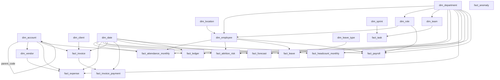

# PulseIQ Analytics Warehouse - Schema Documentation

## 1. Overview

The PulseIQ Analytics Warehouse uses PostgreSQL and the `dw` schema to organize workforce, payroll, finance, operational, and predictive analytics data.

The warehouse contains 23 tables:
- 11 dimension tables
- 12 fact tables

The authoritative schema definitions are maintained in `Warehouse/schema.sql`. The loading and validation process is implemented in `Warehouse/warehouse_loader.py`.

### Design principles

- Use primary keys to identify warehouse records.
- Use foreign keys to enforce declared relationships.
- Use `dim_employee.employee_key` to identify the correct historical employee version.
- Use repeatable upserts for warehouse refreshes.
- Validate source rows, keys, and referential integrity after loading.
- Preserve intentional warehouse members, including the unknown employee and the `ALL` department.

## 2. Dimension Tables

| Table | Purpose | Primary key |
|---|---|---|
| `dim_account` | Financial accounts and account hierarchy | `account_code` |
| `dim_client` | Client reference information | `client_id` |
| `dim_date` | Calendar and reporting dates | `date_key` |
| `dim_department` | Department reference information | `department_id` |
| `dim_employee` | Employee details and historical versions | `employee_key` |
| `dim_leave_type` | Leave category definitions | `leave_type_code` |
| `dim_location` | Work location reference information | `work_location` |
| `dim_role` | Employee role definitions | `role_id` |
| `dim_sprint` | Sprint reference information | `sprint_id` |
| `dim_team` | Team reference information | `team_id` |
| `dim_vendor` | Vendor reference information | `vendor_id` |

The warehouse contains additional dimension members beyond the source CSV counts. These include an unknown employee, an `ALL` department, and additional date records. These members must be preserved during subsequent loads.

## 3. Fact Tables and Grain

Grain defines what one row represents in a fact table. The following descriptions reflect the table purpose and declared primary keys. Business-level grain should be confirmed against source contracts and business rules where necessary.

| Fact table | Primary key | Row grain |
|---|---|---|
| `fact_anomaly` | `result_id` | One anomaly detection result |
| `fact_attendance_monthly` | `attendance_fact_id` | One monthly attendance fact record |
| `fact_attrition_risk` | `prediction_id` | One attrition-risk prediction |
| `fact_expense` | `expense_id` | One expense record |
| `fact_forecast` | `forecast_id` | One forecast record |
| `fact_headcount_monthly` | `date_key`, `department_id` | One department and reporting-date combination |
| `fact_invoice` | `invoice_id` | One invoice |
| `fact_invoice_payment` | `payment_id` | One invoice payment |
| `fact_leave` | `leave_request_id` | One leave request |
| `fact_ledger` | `line_id` | One ledger line |
| `fact_payroll` | `payroll_item_id` | One payroll item |
| `fact_task` | `task_id` | One task |

Primary keys identify warehouse records and do not necessarily represent every business-level uniqueness rule.

## 4. Foreign-Key Relationships

The warehouse has 39 declared foreign-key constraints. PostgreSQL confirmed that all 39 are validated.

### Dimension relationships

- `dim_account.parent_code` references `dim_account.account_code`, representing the account hierarchy.
- `dim_employee.department_id` references `dim_department.department_id`.
- `dim_employee.role_id` references `dim_role.role_id`.
- `dim_employee.work_location` references `dim_location.work_location`.
- `dim_role.department_id` references `dim_department.department_id`.
- `dim_team.department_id` references `dim_department.department_id`.
- `dim_vendor.primary_expense_account` references `dim_account.account_code`.

### Fact relationships

| Fact table | Referenced tables |
|---|---|
| `fact_attendance_monthly` | `dim_date`, `dim_department`, `dim_employee` |
| `fact_attrition_risk` | `dim_date`, `dim_department`, `dim_employee` |
| `fact_expense` | `dim_account`, `dim_date`, `dim_department`, `dim_vendor` |
| `fact_forecast` | `dim_date`, `dim_department` |
| `fact_headcount_monthly` | `dim_date`, `dim_department` |
| `fact_invoice` | `dim_account`, `dim_client`, `dim_date` |
| `fact_invoice_payment` | `fact_invoice`, `dim_date` |
| `fact_leave` | `dim_date`, `dim_employee`, `dim_leave_type` |
| `fact_ledger` | `dim_account`, `dim_date`, `dim_department` |
| `fact_payroll` | `dim_date`, `dim_department`, `dim_employee`, `dim_role` |
| `fact_task` | `dim_sprint`, `dim_team` |

`fact_anomaly` contains employee and period reference fields, but these are not declared foreign keys in the verified schema. The diagram therefore does not represent them as enforced dimension relationships.

`fact_invoice_payment` references `fact_invoice` and `dim_date`. It does not have a declared foreign key directly to `dim_client`.

## 5. Star-Schema Diagram

The following Mermaid diagram summarizes the declared foreign-key relationships. It includes the account hierarchy and the relationship between invoices and invoice payments.

`fact_anomaly` is intentionally shown without dimension links because its employee and period columns do not have declared foreign-key constraints. `Warehouse/schema.sql` remains the source of truth for exact constraints and column definitions.

## 6. Employee History - Slowly Changing Dimension Type 2

`dim_employee` uses `employee_key` as its primary key and surrogate identifier for an employee version.

Important columns include:

- `employee_key`: unique warehouse identifier for an employee version.
- `employee_id`: employee's business identifier.
- `valid_from`: beginning of the version's validity.
- `valid_to`: end of the version's validity.
- `is_current`: indicator for the current version.
- `change_reason`: reason for the historical change.

Facts containing `employee_key` must join to `dim_employee` using that surrogate key. Joining only on `employee_id` can match multiple historical versions and distort historical reporting.

### Validated employee-history results

- 1,606 employee-version rows are present in the source.
- 745 distinct business employee IDs are represented.
- 745 versions are marked current (`Y`).
- 861 historical versions are marked non-current (`N`).
- One unknown employee member exists with `employee_key = -1`.

A known source-data overlap exists for employee `EMP-0001`: one version ends on 2012-05-12, while the next starts on 2012-05-03. The overlapping interval is 10 calendar days when both endpoints are included. This issue remains documented and has not been silently corrected.

## 7. Loading and Data Quality

The loader in `Warehouse/warehouse_loader.py` supports a validation-only dry run and an explicit `--apply` mode.

The loading process:

1. Checks the expected CSV inventory and column mappings.
2. Validates primary-key values and account-parent references.
3. Normalizes compatible source values before loading.
4. Uses PostgreSQL upserts to support repeatable loads.
5. Checks fact-table row counts against source counts.
6. Preserves required warehouse members.
7. Uses a transaction so a failed load can be rolled back.

### Load and constraint validation results

| Validation | Result |
|---|---:|
| Warehouse tables loaded | 23 |
| Dimension tables | 11 |
| Fact tables | 12 |
| Source rows checked during loading | 61,937 |
| Foreign-key constraints | 39 |
| Validated foreign-key constraints | 39 |
| Unvalidated foreign-key constraints | 0 |
| Missing foreign-key index entries reported by the verification query | 0 |

### Fact-table row counts

The following counts were verified directly against PostgreSQL after the repeat load.

| Fact table | Rows |
|---|---:|
| `fact_anomaly` | 405 |
| `fact_attendance_monthly` | 7,343 |
| `fact_attrition_risk` | 430 |
| `fact_expense` | 501 |
| `fact_forecast` | 72 |
| `fact_headcount_monthly` | 891 |
| `fact_invoice` | 743 |
| `fact_invoice_payment` | 709 |
| `fact_leave` | 3,441 |
| `fact_ledger` | 6,784 |
| `fact_payroll` | 7,344 |
| `fact_task` | 28,868 |
| **Total fact rows** | **57,531** |

The overall source total of 61,937 includes dimension rows as well as fact rows. The source total and fact total describe different populations and should not be treated as equal.

### Repeat-load validation

The first applied load completed successfully. A second dry run passed without changing the database. A second applied load also completed successfully.

Exact row counts were captured for all 23 tables before and after the second applied load. All table counts matched the baseline.

This confirms row-count stability after the repeat load. Matching row counts alone does not prove that every individual column value remained unchanged.

### Preserved members

Post-load validation confirmed:

- 90 preserved future-date records.
- One `ALL` department member.
- One unknown employee member with key `-1`.

The loader reported that the transaction committed successfully and no records were deleted.

### Relationship checks

- All 39 declared foreign-key constraints are validated by PostgreSQL.
- The foreign-key index verification query returned zero rows.
- The checked payroll, attendance, and headcount employee/department/date joins returned no missing dimension matches.
- `fact_ledger` contains 5,688 NULL `cost_center_department_id` values and 1,096 populated values. All 1,096 populated department IDs matched `dim_department`; no genuine orphan department references were found in this check.

NULL ledger department values have not been replaced because the available checks do not establish that they are invalid.

## 8. Indexing

Indexes support primary-key lookups, joins, and date-based reporting. The warehouse has primary-key indexes, additional unique indexes, and secondary indexes for relationship and date columns.

Fourteen additional indexes were created for foreign-key columns identified by the index audit. The subsequent verification query returned zero rows.

For further performance review, composite indexes should be evaluated for leading-column suitability, and query plans should be checked for important reporting workloads.

## 9. Schema Maintenance

For future warehouse changes:

- Keep `Warehouse/schema.sql` synchronized with the intended PostgreSQL schema.
- Preserve primary keys, foreign keys, unique constraints, and useful indexes.
- Use repeatable, idempotent loading logic.
- Validate source-to-warehouse row counts after each refresh.
- Check for orphan references and duplicate business keys.
- Preserve the unknown employee, `ALL` department, and required date members.
- Investigate known source-data issues, including employee-version overlaps, before changing historical records.
- Keep credentials in `.env`; never commit secrets to version control.

## 10. Deliverables

- `Warehouse/schema.sql` - PostgreSQL schema definitions.
- `Warehouse/warehouse_loader.py` - validation and repeatable loading process.
- `Docs/warehouse-schema.md` - schema overview, grain definitions, relationships, validation results, and Mermaid diagram.

**Status:** The warehouse load completed successfully across 23 tables and 61,937 source rows. All 39 foreign-key constraints are validated, and the foreign-key index audit returned zero missing entries. A second dry run passed, and a second applied load completed successfully with all 23 table row counts unchanged. The known employee-version overlap remains documented and unchanged. The named reference reconciliation files were not found in the project directory, so reference-based reconciliation remains outstanding.
